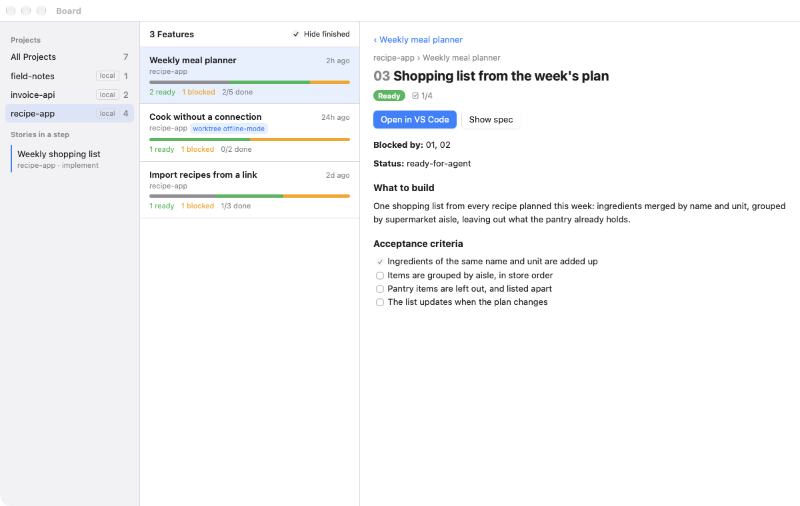
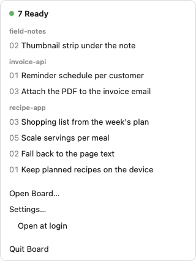

# matt-kanban

A read-only macOS app that shows the tickets made by [Matt Pocock's skills](https://github.com/mattpocock/skills) across all your projects, in one window and in the menu bar.

> Unofficial. This is a personal tool built on top of those skills. It is not affiliated with or endorsed by Matt Pocock.

<picture>
  <source media="(prefers-color-scheme: dark)" srcset="docs/screenshots/board-dark.png">
  
</picture>

## Install

1. Download `Board_<version>_aarch64.dmg` from the latest [Release](https://github.com/stevenk1/matt-kanban/releases/latest), open it and drag Board to Applications. It runs on Apple Silicon Macs only. The Release's other files (`Board.app.tar.gz`, its `.sig` and `latest.json`) are what the Board's updater downloads; you don't need them.
2. Open Board once. It is ad-hoc signed but not notarized, so macOS refuses it the first time: go to System Settings › Privacy & Security, click Open Anyway next to the message about Board, and confirm. That is needed only once.

## First launch

The Board asks for the folder that holds your projects, and shows every Project in it (see [What it shows](#what-it-shows)).

The number of Ready Tickets sits in the menu bar. Click it to open the popover, which lists them by Project:

<p>
  <picture>
    <source media="(prefers-color-scheme: dark)" srcset="docs/screenshots/popover-dark.png">
    
  </picture>
  <br>
  <em>The popover, opened from the Ready count in the menu bar.</em>
</p>

Open Settings with Cmd+, (or Settings… in the popover) to add more folders, hide Projects, set how long Done Tickets stay visible, and turn on Open at login.

## Updates

The Board checks the Releases at launch and once a day. When there is a new version, it asks whether to install it and restart; Later asks again at the next check. An update needs no second Open Anyway, though macOS may ask again for access to a folder it guards, such as Documents or Desktop.

## What it shows

- **Projects**: every folder directly inside a folder you pick that has `docs/agents/issue-tracker.md` (what the skills' setup writes). They're found automatically, including git worktrees.
- **Features and Tickets**: local-markdown trackers (`.scratch/<feature>/spec.md` and `.scratch/<feature>/issues/NN-*.md`) and GitHub Issues trackers (read through `gh`). Each Ticket is shown as Blocked, Ready or Done, from its `Status:` and `Blocked by:` lines.
- **The menu bar**: the number of Ready Tickets, and a popover that lists them.
- **Stories** (optional): see [Story files](#story-files).

The Board never writes to your projects. Its capabilities grant read access only to the folders you pick, and a test checks that they stay read-only.

## Story files

A Story is one run of an agent loop in a Project: what it's for and which step it's on. The Board lists the Stories that are mid-step in its sidebar. Stories are optional: if none of your Projects keeps any, the section doesn't show.

Any tool can write them. A Story is a markdown file at `.scratch/stories/<slug>.md` in a Project:

```markdown
---
goal: One line saying what this run is for
status: active
---

## Log
- 2026-01-01 grill-with-docs: scoped the feature

## Next
Waiting: in-step:implement
Recommended: implement - the tickets are ready
```

- `goal`: shown as the Story's title (defaults to the file name).
- `status`: a Story whose status starts with `done` is hidden.
- `Waiting:` under `## Next`: `in-step:<skill>` puts the Story in the sidebar with that step. Anything else (`next-step`, `stopped`) keeps it out.
- The `Waiting:` line and the last `## Log` bullet show in the Story's tooltip.

## Working on it

The repo is set up for Matt Pocock's skills: `CLAUDE.md` and `docs/agents/` describe the tracker (local markdown, in a git-ignored `.scratch/`), the dev loop and the coding standards. `GLOSSARY.md` holds the domain language, and `docs/adr/` the decisions.

### Build from source

You need macOS, a current Node.js LTS and a Rust toolchain ([Tauri's prerequisites](https://tauri.app/start/prerequisites/)). For Projects that track their work in GitHub Issues, also [`gh`](https://cli.github.com/), logged in, at `/opt/homebrew/bin/gh` or `/usr/local/bin/gh`.

```sh
npm install
npm run app          # development build with hot reload
npx tauri build      # a release .app and .dmg under src-tauri/target/release/bundle/
npm run check        # typecheck, Vitest and the Rust unit tests
```

A local `npx tauri build` also makes the updater's signed bundle, so it needs the updater's private key in `TAURI_SIGNING_PRIVATE_KEY` (and its password in `TAURI_SIGNING_PRIVATE_KEY_PASSWORD`). Without the key, add `--config '{"bundle":{"createUpdaterArtifacts":false}}'`.

### Releasing

Bump `version` in `package.json` (the app takes its version from there), commit, and push a tag `v<version>`. The Release workflow checks the tag against the version, runs `npm run check`, builds and publishes the Release: the `.dmg`, plus the updater's `Board.app.tar.gz`, its `.sig` and `latest.json`.

## License

[MIT](LICENSE)
